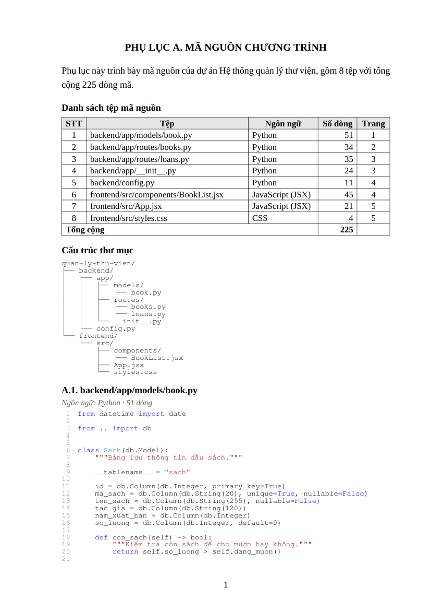
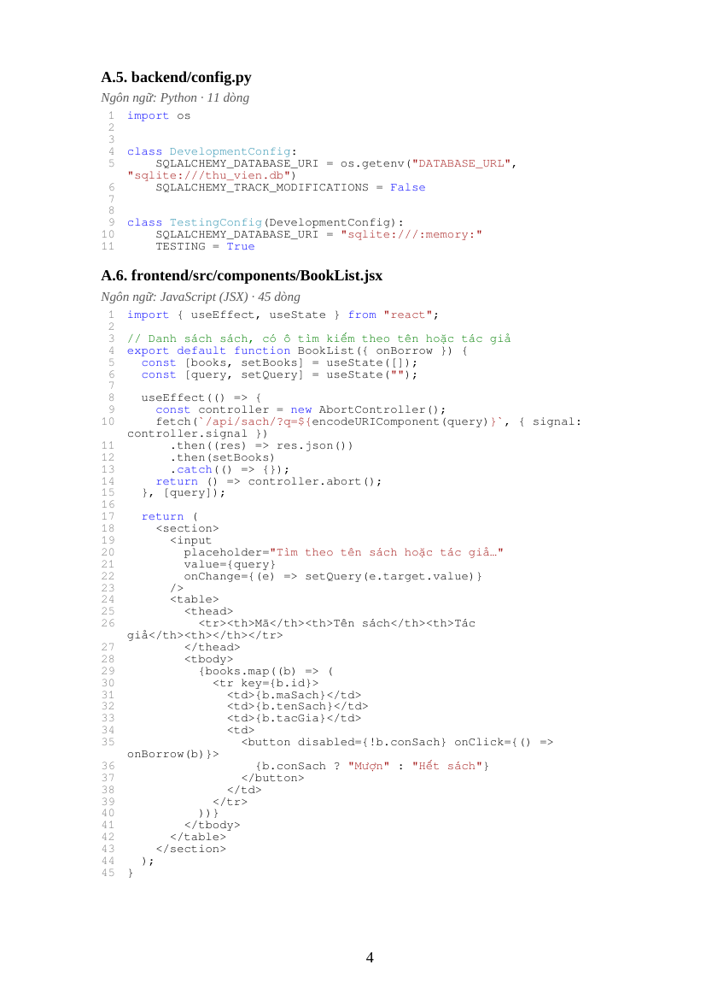

# CodeAppendix

**Xuất mã nguồn dự án thành phụ lục Word (.docx) đúng thể thức, chỉ với một lệnh.**
Dành cho đồ án, khóa luận, báo cáo thực tập, hồ sơ nghiệm thu hay đăng ký bản quyền phần mềm.

```bash
codeappendix ./do-an
# -> do-an-ma-nguon.docx: PHỤ LỤC A, bảng danh sách tệp có số trang,
#    cây thư mục, từng tệp có đánh số dòng và tô màu cú pháp
```

| Trang đầu: danh sách tệp, cây thư mục | Trang mã nguồn |
|---|---|
|  |  |

Xem kết quả mẫu: [PDF](docs/sample-quan-ly-thu-vien.pdf) · [DOCX](docs/sample-quan-ly-thu-vien.docx)

> Ảnh minh họa được xuất bằng LibreOffice nên dùng phông thay thế. Mở bằng Word sẽ đúng
> phông Times New Roman và Consolas.

---

## Vấn đề nó giải quyết

Hầu hết các trường yêu cầu đưa mã nguồn vào phụ lục. Cách thường làm là copy từng tệp vào Word,
chỉnh phông, tự đánh số, tự vẽ cây thư mục. Code sửa một dòng là phải làm lại từ đầu. Các công cụ
có sẵn không làm được việc này:

- **Công cụ in code ra PDF/HTML** không ghép được vào tệp Word của khóa luận.
- **Repomix, gitingest, …** gom code thành tệp văn bản cho AI đọc, không phải tài liệu để nộp.
- **Copy từ VS Code sang Word** mất số dòng, vỡ thụt lề, Word gạch đỏ khắp nơi.

CodeAppendix tạo ra một tệp `.docx` **chỉnh sửa được**. Tiêu đề dùng Heading chuẩn của Word nên
dán vào khóa luận sẽ tự vào mục lục.

## Tính năng

- **Đúng thể thức**: khổ A4, lề trái 3 cm, Times New Roman 13, tiêu đề
  `PHỤ LỤC A. MÃ NGUỒN CHƯƠNG TRÌNH`, các tệp đánh số `A.1`, `A.2`, … Tất cả đổi được.
- **Bảng danh sách tệp** gồm STT, đường dẫn, ngôn ngữ, số dòng và **số trang**. Số trang tự
  cập nhật trong Word và LibreOffice.
- **Cây thư mục** của các tệp được đưa vào.
- **Mã nguồn dễ đọc**: đánh số dòng, dòng dài xuống dòng vẫn thẳng cột, tô màu cú pháp cho hơn
  80 loại tệp. Có chế độ `mono` để in đen trắng. Code không bị Word gạch đỏ chính tả.
- **Tự chọn đúng tệp**:
  - tôn trọng `.gitignore`, kể cả `.gitignore` lồng nhau;
  - bỏ `node_modules`, `venv`, `build`, `dist`, `.git`;
  - bỏ tệp do công cụ sinh ra (`*.g.dart`, migration của Django, `*.pb.go`, `*.Designer.cs`,
    …), tệp đã nén (`*.min.js`) và thư viện chép vào dự án (jQuery, Bootstrap, …);
  - với Flutter/React Native, bỏ các thư mục `android/`, `ios/`, `windows/`, … do framework
    tạo sẵn;
  - không bao giờ lấy `.env` hay tệp nhị phân.
- **Notebook Jupyter**: chỉ lấy các ô code, bỏ phần kết quả.
- **Tệp quá dài**: `--max-lines 200` giữ phần đầu và phần cuối, ghi rõ "lược bỏ N dòng".
- **Xuất PDF** bằng `--pdf` (cần LibreOffice).
- **Đọc được tệp mã hóa cũ** (Windows-1258, UTF-16, …) mà không lỗi font tiếng Việt.

## Cài đặt

Cần Python 3.9 trở lên.

```bash
# Cách khuyên dùng: cài như một công cụ dòng lệnh độc lập
pipx install git+https://github.com/liamhnam/CodeAppendix.git
# hoặc
uv tool install git+https://github.com/liamhnam/CodeAppendix.git
# hoặc
pip install git+https://github.com/liamhnam/CodeAppendix.git
```

Sau khi cài sẽ có hai lệnh giống nhau: `codeappendix` và `phuluc`.

## Bắt đầu nhanh

```bash
# 1. Xem trước những tệp sẽ được lấy (không ghi gì ra đĩa)
codeappendix list ./do-an

# 2. Tạo phụ lục
codeappendix ./do-an

# 3. (Tùy chọn) Lưu cấu hình lâu dài cho dự án
codeappendix init ./do-an      # tạo ./do-an/codeappendix.toml, sửa rồi chạy lại bước 2
```

Mở tệp `.docx` bằng Word. Khi Word hỏi *"This document contains fields that may refer to other
files. Update the fields?"*, chọn **Yes** để điền cột số trang. Nếu lỡ chọn No, nhấn `Ctrl+A`
rồi `F9`.

### Ví dụ thường gặp

```bash
# Bỏ thư mục test, chỉ lấy src, đưa tệp chính lên đầu
codeappendix . -x "tests/" --only "src/**" --order "src/main.py"

# In đen trắng, cỡ chữ nhỏ, mỗi tệp tối đa 150 dòng
codeappendix . --highlight mono --preset compact --max-lines 150

# Phụ lục B, không đưa tên tệp vào mục lục khóa luận
codeappendix ./frontend --label B --plain-headings -o phu-luc-b.docx

# Thêm tệp cấu hình/giao diện không phải mã nguồn
codeappendix . -i "*.json" -i "app/src/main/res/layout/*.xml"

# Kèm bản PDF
codeappendix . --pdf

# Tài liệu tiếng Anh, khổ Letter
codeappendix . --preset us-letter
```

## Ghép vào khóa luận

1. Mở tệp phụ lục, nhấn `Ctrl+A`, `Ctrl+C`.
2. Trong khóa luận, đặt con trỏ ở vị trí phụ lục, dùng **Paste → Keep Source Formatting** (hoặc
   Merge Formatting nếu muốn theo style của khóa luận).
3. Tiêu đề phụ lục (Heading 1) và tên từng tệp (Heading 2) sẽ vào mục lục khi bạn cập nhật mục
   lục. Nếu không muốn từng tệp xuất hiện trong mục lục, tạo phụ lục với `--plain-headings`.

Có thể tạo nhiều phụ lục (A cho backend, B cho frontend) rồi dán chung vào một khóa luận. Cột số
trang của mỗi phụ lục không bị lẫn sang phụ lục kia.

## Quy tắc chọn tệp

Tệp được xét theo thứ tự sau (mẫu đường dẫn theo cú pháp `.gitignore`: `*.json` khớp ở mọi cấp,
`src/**` là mọi thứ trong `src`, `/build` chỉ ở gốc):

1. Khớp `exclude` thì **luôn bị bỏ**.
2. Nếu có `only` thì chỉ giữ tệp khớp `only`.
3. Khớp `include` thì **luôn được lấy**, kể cả khi bị `.gitignore` hay quy tắc mặc định loại.
4. Còn lại, tệp được lấy nếu không bị `.gitignore` loại, không nằm trong thư mục thư viện, build
   hay thư mục ẩn, và là mã nguồn.

Tệp nhị phân, tệp rỗng và tệp lớn hơn `max_file_kb` (mặc định 1 MB) luôn bị bỏ. Chạy
`codeappendix list . --verbose` để xem lý do từng tệp bị bỏ.

**Được tính là mã nguồn**: Python, Jupyter, R, Julia, SQL, JavaScript/TypeScript (JSX/TSX), Vue,
Svelte, Astro, HTML, CSS/SCSS/Sass/Less, PHP, Twig, EJS, Handlebars, Pug, JSP, Razor, ERB, Java,
Kotlin, Scala, Groovy/Gradle, Clojure, C, C++, Arduino, C#, VB.NET, F#, XAML, Go, Rust, Zig, Swift,
Objective-C, Dart, Assembly, Verilog/VHDL, Pascal/Delphi, Fortran, Solidity, Ruby, Lua, Perl,
Elixir, Erlang, Haskell, OCaml, Elm, Nim, Shell, PowerShell, Batch, Protocol Buffers, GraphQL,
Dockerfile, Makefile, CMake.

JSON, YAML, XML, Markdown và `.txt` không được lấy mặc định. Thêm bằng `include` nếu cần.

## Tùy chọn dòng lệnh

```text
codeappendix [build] [PATH] [tùy chọn]   tạo .docx (lệnh mặc định)
codeappendix list    [PATH] [tùy chọn]   xem trước danh sách tệp (-v: liệt kê mọi tệp bị bỏ)
codeappendix init    [PATH]              tạo codeappendix.toml có chú thích
```

| Tùy chọn | Ý nghĩa |
|---|---|
| `-o, --output FILE` | Tệp đầu ra (mặc định `./<tên-thư-mục>-ma-nguon.docx`) |
| `--pdf` | Xuất thêm PDF (cần LibreOffice) |
| `-c, --config FILE` | Tệp cấu hình (mặc định `PATH/codeappendix.toml` nếu có) |
| `-p, --preset` | `vn-thesis` (mặc định), `compact`, `us-letter` |
| `--lang vi\|en` | Ngôn ngữ nhãn trong tài liệu và thông báo |
| `-i, --include GLOB` | Thêm tệp khớp mẫu (lặp lại được) |
| `-x, --exclude GLOB` | Bỏ tệp/thư mục khớp mẫu (lặp lại được) |
| `--only GLOB` | Chỉ lấy tệp khớp mẫu |
| `--order GLOB` | Đưa các tệp khớp lên đầu, theo thứ tự |
| `--title`, `--label`, `--name` | Tiêu đề, chữ cái phụ lục (`''` để bỏ), tên dự án trong lời dẫn |
| `--tree included\|all\|none` | Cây thư mục: tệp được lấy, mọi tệp, hoặc không có |
| `--no-summary`, `--no-file-info` | Bỏ bảng danh sách tệp / bỏ dòng "Ngôn ngữ · số dòng" |
| `--plain-headings` | Tên tệp là chữ đậm thường, không vào mục lục |
| `--page-break` | Mỗi tệp bắt đầu ở trang mới |
| `--highlight color\|mono\|none`, `--theme` | Kiểu tô màu và bảng màu Pygments (mặc định `vs`) |
| `--no-line-numbers`, `--max-lines N` | Tắt số dòng / giới hạn số dòng mỗi tệp |
| `--font`, `--font-size`, `--code-font`, `--code-size`, `--page-size` | Phông chữ và khổ giấy |
| `--no-gitignore`, `--no-default-excludes`, `--keep-generated`, `--keep-minified`, `--max-file-kb` | Nới các quy tắc lọc |

Chạy `codeappendix build --help` để xem đầy đủ.

## Tệp cấu hình

`codeappendix init` tạo tệp `codeappendix.toml` có sẵn mọi thiết lập kèm chú thích. Tệp này nên
được commit cùng dự án để cả nhóm xuất ra cùng một định dạng. Thứ tự ưu tiên: preset < tệp cấu
hình < tùy chọn dòng lệnh. Riêng `include`/`exclude`/`only`/`order` trên dòng lệnh được **cộng
thêm** vào danh sách trong tệp cấu hình.

```toml
preset = "vn-thesis"

[document]
label = "A"
project_name = "Hệ thống quản lý thư viện"

[page]
margin_left = 3.5          # trường yêu cầu lề trái 3,5 cm

[code]
code_size = 9.5
highlight = "mono"
max_lines = 300

[files]
exclude = ["tests/**", "**/migrations/**"]
order = ["backend/app/__init__.py", "backend/app/**"]
```

Sai tên khóa hay giá trị không hợp lệ sẽ được báo rõ, kèm gợi ý (ví dụ
`did you mean 'code_size'?`).

## Câu hỏi thường gặp

**Cột "Trang" bị trống?** Word chỉ điền số trang khi cập nhật trường: chọn **Yes** khi mở tệp,
hoặc nhấn `Ctrl+A`, `F9`. LibreOffice tự điền. Google Docs có thể không hiển thị số trang.

**Số trang CLI báo khác số trang thật?** Con số in ra là ước lượng (sai khoảng ±10%), vì cách
xuống dòng phụ thuộc phông chữ trên máy. Dùng `--pdf` để biết chính xác.

**Máy không có phông Consolas?** Đổi sang phông khác, ví dụ `--code-font "Courier New"`. Consolas
có sẵn trên Windows và đi kèm Microsoft Office trên macOS.

**`--pdf` báo không tìm thấy LibreOffice?** Cài [LibreOffice](https://www.libreoffice.org/), hoặc
mở `.docx` bằng Word rồi chọn *File → Save As → PDF*. Trên Linux cần gói `libreoffice-writer`.

**Một tệp mình viết bị bỏ vì bị coi là "do công cụ sinh ra"?** Tệp bị coi là sinh tự động khi
10 dòng đầu có chú thích như `Generated by`, `DO NOT EDIT`, `@generated`. Thêm nó bằng `include`,
hoặc dùng `--keep-generated`.

## Phát triển

```bash
git clone https://github.com/liamhnam/CodeAppendix.git
cd CodeAppendix
pip install -e ".[test]"
pytest
```

Cấu trúc mã nguồn (`src/codeappendix/`):

- `scanner.py`: duyệt thư mục và chọn tệp.
- `reader.py`: đọc tệp, nhận diện mã hóa, loại tệp sinh tự động hoặc đã nén.
- `highlight.py`: tô màu bằng Pygments.
- `docx_writer.py`: dựng tài liệu Word.
- `config.py`: các preset và tệp cấu hình.
- `cli.py`: giao diện dòng lệnh.

---

## English

**CodeAppendix** turns a project's source code into a formatted, editable Word (`.docx`) appendix.
You get a file list with page numbers, a directory tree, and every file with line numbers and
syntax highlighting. Use it for theses, internship reports, project hand-over documents or
software-copyright filings.

It honours `.gitignore` and skips dependencies, build output, generated, minified and vendored
files. It can also export a PDF through LibreOffice.

```bash
pipx install git+https://github.com/liamhnam/CodeAppendix.git
codeappendix list .                   # preview the selection
codeappendix . --preset us-letter     # English labels, US Letter, 1" margins
codeappendix . --pdf -x "tests/"      # also export a PDF, leave tests out
```

See the option table and configuration file above; option names are in English.

## Giấy phép

MIT. Xem [LICENSE](LICENSE).
